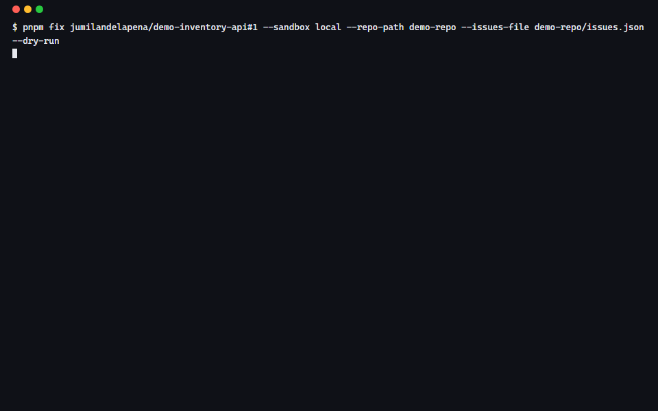
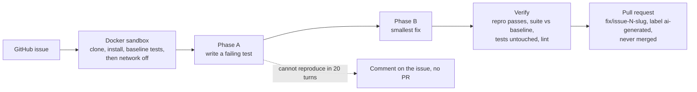

# autofix-agent

A mini SWE-agent you can read in an afternoon. Give it a GitHub issue URL and
it clones the repository into a Docker sandbox, writes a failing test that
reproduces the bug, fixes it, proves the test passes and nothing else broke,
and opens a pull request for a human to review. The agent loop is written by
hand on the Claude Messages API (no framework), every tool runs inside an
offline container, every turn is logged to a trajectory you can replay, and
the run stops itself on step, cost and time limits.



*Recorded from a real `pnpm fix` dry run with the mock provider (the model
turns are replayed, every tool call is executed). Re-record with
`pnpm demo:gif -- <issue-url>` after a live run.*

## The six pull requests

The agent is evaluated on [demo-inventory-api](https://github.com/jumilandelapena/demo-inventory-api),
a small Express + TypeScript API with six planted bugs
([`demo-repo/issues.json`](demo-repo/issues.json)). Each bug is filed as an
issue there and `pnpm eval` opens one PR per issue.

| Issue | PR |
|---|---|
| [#1 GET /items?limit=N returns N+1 items](https://github.com/jumilandelapena/demo-inventory-api/issues/1) | opened by the first live `pnpm eval` run (see below) |
| [#2 Discount subtracted as a dollar amount](https://github.com/jumilandelapena/demo-inventory-api/issues/2) | same |
| [#3 PUT /items/:id not persisted](https://github.com/jumilandelapena/demo-inventory-api/issues/3) | same |
| [#4 Search is case-sensitive](https://github.com/jumilandelapena/demo-inventory-api/issues/4) | same |
| [#5 DELETE unknown id deletes another item](https://github.com/jumilandelapena/demo-inventory-api/issues/5) | same |
| [#6 slugify leaves a trailing hyphen](https://github.com/jumilandelapena/demo-inventory-api/issues/6) | same |

All PRs: <https://github.com/jumilandelapena/demo-inventory-api/pulls?q=label%3Aai-generated>.
The build session for this repository had no `ANTHROPIC_API_KEY`, so the
table and `docs/eval-results.md` currently come from the mock provider. The
live run is one command: `pnpm eval` with the key and a token in the
environment; it rewrites the results file and the PR links.

## How it works



1. **Fetch the issue.** `https://github.com/owner/repo/issues/N` or `owner/repo#N`; title, body, labels and comments via Octokit.
2. **Build the sandbox.** A fresh container from [`sandbox/Dockerfile`](sandbox/Dockerfile) (git, Node 20, Python 3.11 + uv, Go, ripgrep, user `agent`) with 2 CPUs, 4 GB RAM, 512 pids and a 30-minute wall clock. The clone is streamed in as a tar; nothing is mounted. The project type is detected from `package.json` / `pyproject.toml` / `requirements.txt` / `go.mod`, dependencies are installed, the suite runs once for a baseline, and the container is disconnected from the network.
3. **Phase A, reproduce.** The model gets seven strict tools (`bash`, `read_file`, `edit_file`, `write_file`, `search`, `run_tests`, `submit`) and must write a test that fails. The harness notices the first failing run of a newly written test and only then unlocks Phase B. Twenty turns without that: stop, comment on the issue with what was tried, no PR.
4. **Phase B, fix.** Smallest change, then the full suite.
5. **Verify.** `submit` is a tool whose answer the harness decides: the repro test must pass, no test may fail that passed in the baseline, pre-existing test files may gain lines but not lose any, no test file may be deleted, the linter must still pass, and a non-test file must have changed. A rejection goes back to the model as an error result.
6. **Pull request.** The diff is copied out of the container as a patch, applied to the host clone, committed on `fix/issue-N-slug` with a Conventional Commits message, pushed, and opened as a PR with root cause, change summary, the new test, before/after test output, steps, tokens, cost, `Closes #N`, a review checklist and the `ai-generated` label. `--dry-run` prints the diff instead. If pushing is not permitted, `pr.md` is written and the run says so.

Details, including every failure mode, are in [docs/architecture.md](docs/architecture.md).

## Safety

- **Sandbox limits.** 2 CPUs, 4 GB memory (no extra swap), 512 processes, `no-new-privileges`, trimmed capabilities, non-root user, 30-minute wall clock that kills the container, per-command timeout (default 120 s, max 600 s), output capped at 2 MB per command.
- **No network.** The container is disconnected from every Docker network after dependencies are installed; the test in [`tests/sandbox.docker.test.ts`](tests/sandbox.docker.test.ts) asserts that only `lo` remains.
- **No secrets in the container.** `ANTHROPIC_API_KEY` and `GITHUB_TOKEN` are read on the host only; the container's environment is fixed at creation and the push token travels in a one-off `http.extraheader`, never into `.git/config`.
- **Denylist.** `rm -rf /`, `git push`, `curl`, `wget`, `npm/pnpm/yarn publish`, `twine upload`, `uv publish`, `sudo`, `docker`, `ssh`/`nc` and friends are refused before they reach the sandbox ([`src/agent/limits.ts`](src/agent/limits.ts)).
- **Step and cost caps.** `--max-steps` (60 turns, 20 for Phase A) and `--budget-usd` (5) computed from `usage` after every turn; a limit hit ends the run with a report and keeps the partial patch in `runs/<id>/fix.patch`.
- **Human review only.** The agent never merges and refuses to commit to `main`, `master` or the base branch. Every PR carries the `ai-generated` label and a checklist.
- **Paths and inputs.** Every tool input is validated with zod before execution; paths are resolved under `/workspace` and anything that escapes it is rejected.

## Eval results

From [`docs/eval-results.md`](docs/eval-results.md), produced by `pnpm eval`:

| # | Issue | Reproduced | Fixed | Suite green | Steps | Time | Cost | Outcome |
|---|---|---|---|---|---|---|---|---|
| 1 | GET /items?limit=N returns N+1 items | yes | yes | yes | 7 | 24s | $0.0000 | submitted |
| 2 | Discount is subtracted as a dollar amount instead of a percentage | yes | yes | yes | 7 | 25s | $0.0000 | submitted |
| 3 | PUT /items/:id returns the updated item but the change is not persisted | yes | yes | yes | 7 | 25s | $0.0000 | submitted |
| 4 | Search is case-sensitive although it is documented as case-insensitive | yes | yes | yes | 7 | 24s | $0.0000 | submitted |
| 5 | DELETE /items/:id with an unknown id returns 204 and deletes a different item | yes | yes | yes | 7 | 26s | $0.0000 | submitted |
| 6 | slugify leaves a trailing hyphen when the name ends with punctuation | yes | yes | yes | 6 | 24s | $0.0000 | submitted |

**6/6 fixed · 41 steps · 2.5 min · $0 (mock provider).** These numbers come
from `LLM_PROVIDER=mock`: the assistant turns are replayed from
[`evals/fixtures/mock`](evals/fixtures/mock), but the sandbox, the test runs,
the phase logic, the verification and the patch are real, so the table proves
the harness, not the model. A live run with Claude Opus 5.5 replaces it; with
prompt caching a fix of this size is expected to land around 7 to 15 turns
and well under a dollar.

## Run it

```bash
pnpm install
cp .env.example .env        # ANTHROPIC_API_KEY, GITHUB_TOKEN
pnpm sandbox:build          # builds autofix-sandbox:latest (also done on first use)

# Fix a real issue and open a PR
pnpm fix https://github.com/jumilandelapena/demo-inventory-api/issues/5

# Same, but stop before pushing and print the diff
pnpm fix jumilandelapena/demo-inventory-api#5 --dry-run --max-steps 40 --budget-usd 2

# Run the eval on all six demo issues (opens six PRs; add --dry-run to keep it local)
pnpm eval
```

Flags: `--dry-run`, `--max-steps <n>` (60), `--budget-usd <n>` (5),
`--base-image <tag>`, `--sandbox docker|local`, `--repo-path <dir>`,
`--issues-file <file>`, `--fixture <file>`, `--provider anthropic|mock`,
`--model <id>`, `--runs-dir <dir>`.

Every run writes `runs/<timestamp>-issue-N/` with `trajectory.jsonl`,
`trajectory.html` (open it over http, e.g. `npx serve runs/<id>`, or drop the
JSONL onto it), `fix.patch`, `pr.md` and `summary.json`.

### Without an API key or Docker

```bash
LLM_PROVIDER=mock pnpm fix jumilandelapena/demo-inventory-api#1 \
  --repo-path demo-repo --issues-file demo-repo/issues.json --dry-run --sandbox local
```

`LLM_PROVIDER=mock` replays `evals/fixtures/mock/issue-<N>.json`;
`--issues-file` reads the issue from JSON instead of GitHub; `--repo-path`
clones from a local directory; `--sandbox local` runs in a directory on the
host (no isolation, development only). CI uses the mock provider with the
real Docker sandbox. `pnpm fixture:from-run runs/<id>/trajectory.jsonl`
turns a live run into a replayable fixture.

## Tests and CI

`pnpm test` (vitest):

- issue URL parser, both forms and bad input;
- command denylist and output truncation;
- `edit_file` rejects zero or multiple matches, `write_file` refuses to overwrite existing tests, `bash` timeouts;
- test-summary parsers for vitest, jest, pytest and `go test`;
- the Docker sandbox: starts a container, runs as the non-root user, enforces the timeout, writes and reads files, has network before and none after `disconnectNetwork()`, applies the resource limits (skipped automatically where no daemon is reachable);
- PR body: before/after output, stats row, checklist, mock marker, trimming;
- end to end with the mock provider on `demo-repo`: the failing test is written and seen failing, the fix applied, the suite green, the diff byte-identical to [`evals/fixtures/mock/issue-1.diff`](evals/fixtures/mock/issue-1.diff), plus a recording that never reproduces and ends with a comment instead of a PR.

[`ci.yml`](.github/workflows/ci.yml) builds the sandbox image, typechecks and
runs the whole suite including the Docker tests, then runs `pnpm fix` with
the mock provider through the Docker sandbox and asserts a green suite and a
non-empty diff, uploading `trajectory.jsonl` and `trajectory.html` as
artifacts. [`fix-live.yml`](.github/workflows/fix-live.yml) is a
`workflow_dispatch` with an `issue_url` input that runs the real agent with
the repository secrets and opens the PR.

## Design decisions

- **Reproduce first.** A fix without a failing test is a guess. Gating Phase B on a test the harness saw fail gives the PR a "before" and makes the repro test the acceptance criterion the harness can re-run.
- **A manual loop, no framework.** The loop is ~150 lines ([`src/agent/loop.ts`](src/agent/loop.ts)) and every decision is visible: when to stop, what to do on `max_tokens` and `refusal`, how tool results are batched, where the cache breakpoints go. Frameworks hide exactly the parts an employer wants to see, and the parts that cost money.
- **Strict tools with zod.** `strict: true` makes the API guarantee the argument shape; `safeParse` on the host guarantees it again before anything touches the sandbox. Bad input becomes an error result, not an exception.
- **The harness verifies, the model proposes.** `submit` is accepted only after the suite is re-run against the baseline and existing tests are checked for deletions. "The model said it passed" is never the evidence.
- **Prompt caching and context editing.** The system prompt is frozen per run and cached; the latest tool result carries the second breakpoint, so each turn reads the whole prefix from cache (`cache_read_input_tokens` is logged per turn and shown in the viewer). Past 150k input tokens the request switches to the beta surface with `clear_tool_uses_20250919` so stale tool outputs stop being resent.
- **The PR is never merged.** The agent's job ends at a reviewable artifact with evidence attached. The `ai-generated` label and checklist are there so a reviewer knows what to check, not whether to trust it.
- **Cost per fix.** Input $4, output $20, cache writes $5, cache reads $0.20 per million tokens (Claude Opus 5.5). A 7-turn fix on a small repo is dominated by cache reads; the budget cap is enforced from real `usage`, not estimated.
- **Steps are turns.** One step is one Messages API call, which may carry several tool calls. That is what costs time and money, so that is what the caps count.

## Limitations and roadmap

- **Flaky tests.** A test that fails intermittently in the baseline is treated as a pre-existing failure, but a test that is flaky only after the change can block a correct fix. Next: re-run failures once before rejecting.
- **Monorepos.** Detection looks at the repository root. A `packages/*` layout needs a `--workdir` to point the sandbox at the right package.
- **Issues that need design decisions.** The agent is built for bugs with an observable wrong behaviour. Feature requests and ambiguous reports end in "could not reproduce" with a comment, which is the intended outcome.
- **Baseline red suites.** A repository whose suite already fails gets compared failure-by-failure; it works, but unparsed reporters fall back to the exit code and lose that precision.
- **GitLab.** The GitHub layer is one interface ([`src/github/types.ts`](src/github/types.ts)) with two implementations; a GitLab client (merge requests, `Closes #N` semantics) is the obvious next one.
- **One container runtime.** Docker only; Podman via `DOCKER_HOST` is untested.

## Publishing (first time)

```bash
# this repository
gh repo create autofix-agent --public --source . --push

# the demo repository, as its own repo, and its six issues
cd demo-repo && git init -b main && git add -A && git commit -m "chore: demo inventory api with six planted bugs"
gh repo create demo-inventory-api --public --source . --push
node -e 'for (const i of require("./issues.json").issues) console.log(i.number, i.title)'
# then, one per issue (in order, so the numbers match issues.json):
gh issue create --title "<title>" --body-file <(node -e 'console.log(require("./issues.json").issues[0].body)') --label bug
```

## License

MIT
